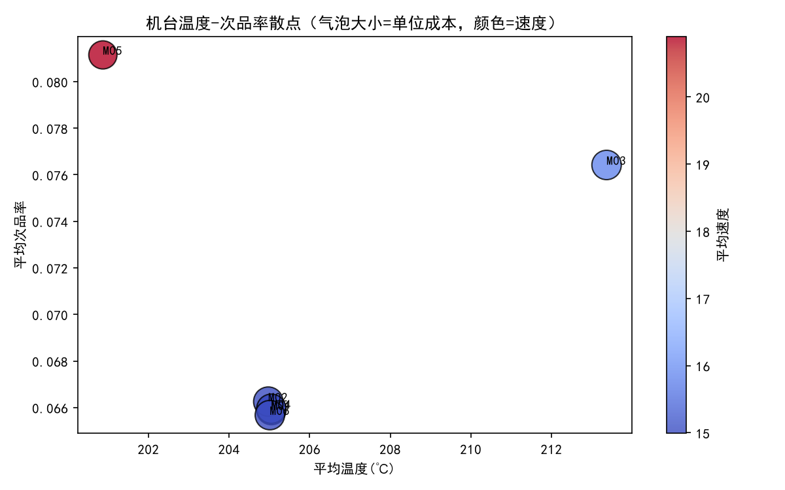
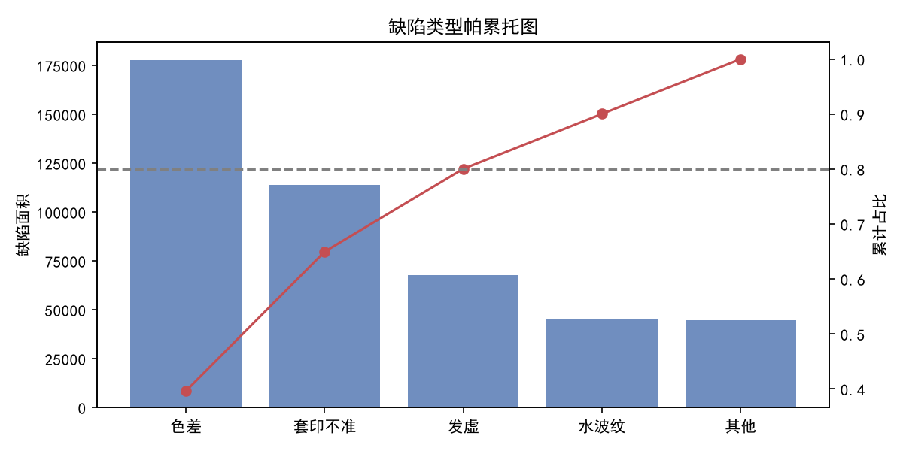
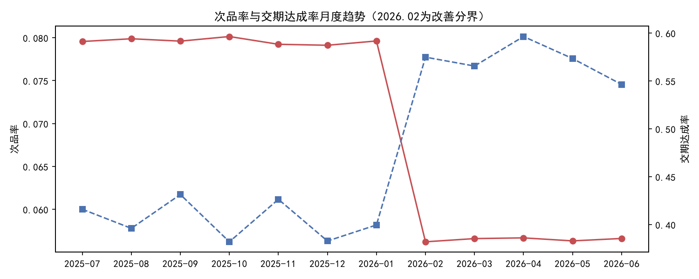

# 转移印花生产数据分析项目

一个完整的「制造车间生产数据分析」项目：从模拟数据生产、数据清洗、指标建模，到 **Hive 数据仓库分层建模** 与可视化分析。

项目用 **两种技术路线** 实现了同一套分析逻辑，便于对照理解：

| 路线 | 定位 | 用到的组件 |
| --- | --- | --- |
| 轻量路线 | 单机快速分析 | Python + Pandas + SQLite + Power BI |
| 数仓路线 | 企业级分层建模 | HDFS + Hive（ODS / DWD / DWS / ADS）+ MySQL 元数据 |

---

## 一、业务背景与要解决的问题

转移印花车间在 **2026 年 2 月** 推行了一轮工艺改善（温度、速度标准化），管理层需要回答四个问题：

1. **改善到底有没有效果？** 次品率、返工率、交期达成率、单位成本改善前后各是多少？
2. **哪些机台是异常点？** 哪台机器次品率或单位成本明显偏高？
3. **缺陷集中在哪？** 缺陷类型是否符合帕累托法则（少数类型占大部分缺陷）？
4. **工艺参数相关性如何？** 温度、速度与次品率之间是否存在相关关系？

---

## 二、数据说明

数据为 **模拟生成**（`scripts/generate_data.py`，固定随机种子 `42`），可完整复现，不含任何真实客户信息。

| 表名 | 说明 | 行数 |
| --- | --- | --- |
| orders | 订单表（客户、花型、面积、交期） | 6,000 |
| prod_record | 生产明细（按“卷”记录，含温度/速度/工时） | 117,099 |
| quality_inspect | 质检明细（检验面积、缺陷面积、缺陷类型） | 117,099 |
| production_plan | 排产计划 | 12,040 |
| dim_machine | 机台维度（额定速度/功率） | 6 |
| dim_customer | 客户维度 | 6 |
| dim_pattern | 花型维度 | 5 |

> 数据中已内置三处「真实业务特征」，用于验证分析方法是否有效：
> - 机台 M03 温度波动大 → 次品率偏高；M05 速度快 → 效率高但质量不稳
> - 缺陷类型按 40% / 25% / 15% / 10% / 10% 分布，符合帕累托特征
> - 2026-02 之后温度、速度向标准值收敛，次品率与交期同步改善

---

## 三、数据仓库分层设计

```
        ┌─────────────────────────────────────────────┐
 原始   │  CSV 文件（HDFS: /transfer_printing_dw/ods） │
        └───────────────────┬─────────────────────────┘
                            ▼
 ODS    ods_orders / ods_prod_record / ods_quality_inspect /
 (贴源) ods_production_plan / ods_dim_machine / ods_dim_customer / ods_dim_pattern
        · 外部表，全字段 STRING，保留原始形态，可回溯
                            ▼
 DWD    dwd_orders_clean / dwd_prod_clean / dwd_qual_clean
 (明细) dim_machine / dim_customer / dim_pattern
        · 去重、剔除异常值、字段类型转换
                            ▼
 ADS    ads_wide_order_machine   ← 核心宽表（订单 × 机台 × 班组）
 (应用) ads_defect_pareto / ads_machine_summary /
        ads_improve_compare / ads_monthly_trend
        · 直接服务于 Power BI / Python 的分析场景
```

分层脚本位于 `sql/`，按顺序执行即可：

| 文件 | 作用 |
| --- | --- |
| `sql/01_ods_ddl.sql` | 建库 + 7 张 ODS 外部表，映射 HDFS 上的 CSV |
| `sql/02_dwd_transform.sql` | 清洗与类型转换，产出 DWD 明细表 + 维度表（ORC） |
| `sql/03_ads_transform.sql` | 产出宽表与 4 张指标汇总表（ORC） |

---

## 四、核心指标口径

| 指标 | 计算口径 | 业务含义 |
| --- | --- | --- |
| 次品率 defect_rate | 缺陷面积 / 检验面积 | 质量水平 |
| 返工率 rework_rate | 返工次数 / 检验次数 | 质量稳定性 |
| 交期达成率 on_time_rate | 准时订单数 / 总订单数 | 交付能力 |
| 机台效率 machine_efficiency | (产出面积 / 运行时长) / 额定速度 | 设备利用水平 |
| 单位成本 unit_cost | (材料 15×面积 + 人工 80×工时 + 能耗 0.8×功率×工时 + 返工 8×缺陷面积) / 产出面积 | 综合成本 |

---

## 五、目录结构

```
transfer-printing-dw/
├── README.md
├── requirements.txt
├── .gitignore
├── sql/                        # Hive 数仓分层脚本
│   ├── 01_ods_ddl.sql
│   ├── 02_dwd_transform.sql
│   └── 03_ads_transform.sql
├── scripts/                    # Python 与 SQLite 侧脚本
│   ├── generate_data.py        # 模拟数据生成（种子 42，可复现）
│   ├── load_to_sqlite.py       # CSV -> SQLite
│   ├── cleaning_and_wide_table.sql  # SQLite 清洗 + 宽表 + 指标
│   ├── analysis.py             # Pandas/NumPy 分析 + 三张图表
│   └── desensitize.py          # 生成脱敏样本（上传用）
├── data/
│   └── sample/                 # 脱敏后的小样本（500 单，可关联）
└── docs/
    └── img/                    # 分析图表
```

---

## 六、如何使用

### 1. 生成模拟数据

```bash
python scripts/generate_data.py
```

### 2. 轻量路线（SQLite）

```bash
python scripts/load_to_sqlite.py                      # CSV -> transfer_printing.db
sqlite3 transfer_printing.db < scripts/cleaning_and_wide_table.sql
python scripts/analysis.py                            # 输出三张图表
```

### 3. 数仓路线（Hive）

前置：已部署 Hadoop 3.3.6 + Hive 3.1.3 + MySQL 8（元数据库）。

```bash
# 上传原始 CSV 到 HDFS
hdfs dfs -mkdir -p /transfer_printing_dw/ods/orders
hdfs dfs -put orders.csv /transfer_printing_dw/ods/orders/

# 按顺序执行分层脚本
hive -f sql/01_ods_ddl.sql
hive -f sql/02_dwd_transform.sql
hive -f sql/03_ads_transform.sql

# 校验
hive -e "select count(*) from transfer_printing_dw.ads_wide_order_machine;"
```

### 4. 生成脱敏样本

```bash
python scripts/desensitize.py --src <原始CSV目录> --out data/sample --orders 500
```

脱敏规则：客户 `客户甲 → CUST_001`、花型 `花型A → PAT_001`、班组 `A班 → TEAM_A`；
只保留被抽中订单及其关联的生产 / 质检 / 排产记录，保证样本内部仍可关联分析。

---

## 七、分析结论

### 7.1 工艺改善效果（改善前 vs 改善后）

数据来源：Hive `ads_improve_compare` 表（SQLite 路线可复现同一结果）。

| 指标 | 改善前 | 改善后 | 变化 |
| --- | ---: | ---: | ---: |
| 订单数 | 3,542 | 2,458 | — |
| 次品率 | 7.96% | 5.65% | **-29.0%** |
| 返工率 | 3.19% | 2.26% | **-29.2%** |
| 交期达成率 | 82.38% | 89.83% | **+7.45pp** |
| 平均延误天数（仅延期订单） | 3.10 | 1.79 | **-42.3%** |
| 机台效率 | 0.8544 | 0.8395 | -1.7% |
| 单位成本（元/㎡） | 22.96 | 22.90 | -0.3% |

**结论**：质量与交期改善显著（次品率、返工率下降约 29%，平均延误下降 42%），但机台效率与单位成本基本持平。
原因是温度、速度向标准值收敛后，设备不再靠"超速换产量"，属于**以极小效率让步换取质量与交付稳定**，总体划算。

### 7.2 机台异常点定位



| 机台 | 次品率 | 平均温度 | 平均速度 | 机台效率 | 单位成本 |
| --- | ---: | ---: | ---: | ---: | ---: |
| M05 | 8.11% | 200.9 | 20.9 | 0.9238 | 21.37 |
| M03 | 7.64% | 213.4 | 15.8 | 0.9613 | 23.31 |
| M02 | 6.63% | 205.0 | 15.0 | 0.8233 | 23.26 |
| M04 | 6.59% | 205.0 | 15.0 | 0.7408 | 23.10 |
| M01 | 6.59% | 205.0 | 15.0 | 0.8226 | 23.26 |
| M06 | 6.57% | 205.0 | 15.0 | 0.8225 | 23.26 |

- **M05**：平均速度 20.9 远超同组水平，效率最高但次品率最高，属于"跑太快牺牲质量"。
- **M03**：平均温度 213.4℃ 明显偏离 205℃ 标准值，次品率高且单位成本最高（23.31 元/㎡），是最优先的改善对象。
- **M06**：各项指标最均衡，可作标杆机台。

### 7.3 缺陷类型帕累托



| 缺陷类型 | 缺陷面积(㎡) | 占比 | 累计占比 |
| --- | ---: | ---: | ---: |
| 色差 | 177,821.05 | 39.63% | 39.63% |
| 套印不准 | 113,677.92 | 25.34% | 64.97% |
| 发虚 | 67,618.10 | 15.07% | 80.04% |
| 水波纹 | 44,831.57 | 9.99% | 90.03% |
| 其他 | 44,741.40 | 9.97% | 100% |

前 3 类缺陷累计占比 **80.0%**，符合帕累托法则，质量改善应优先攻克「色差 + 套印不准」。

### 7.4 月度趋势



次品率在 2026-02 分界点出现**阶跃式下降**（7.96% → 5.62%），交期达成率同步从 82% 提升并稳定在 89%~92%，
说明改善措施在分界点后立即生效且效果持续。

---

## 八、环境版本

- Python 3.14 / Pandas / NumPy / Matplotlib
- Hadoop 3.3.6（HDFS + YARN，伪分布式）
- Hive 3.1.3（元数据库 MySQL 8.0）
- Power BI Desktop（看板）
